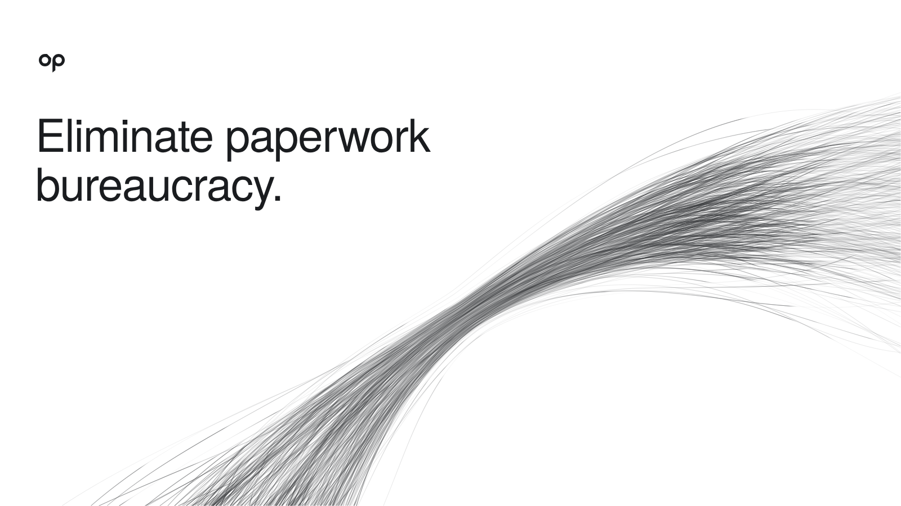
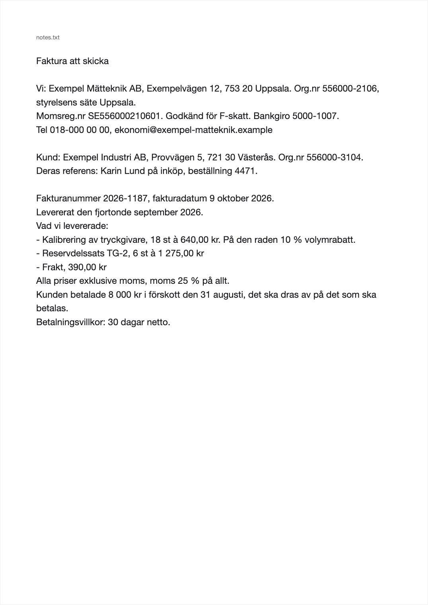
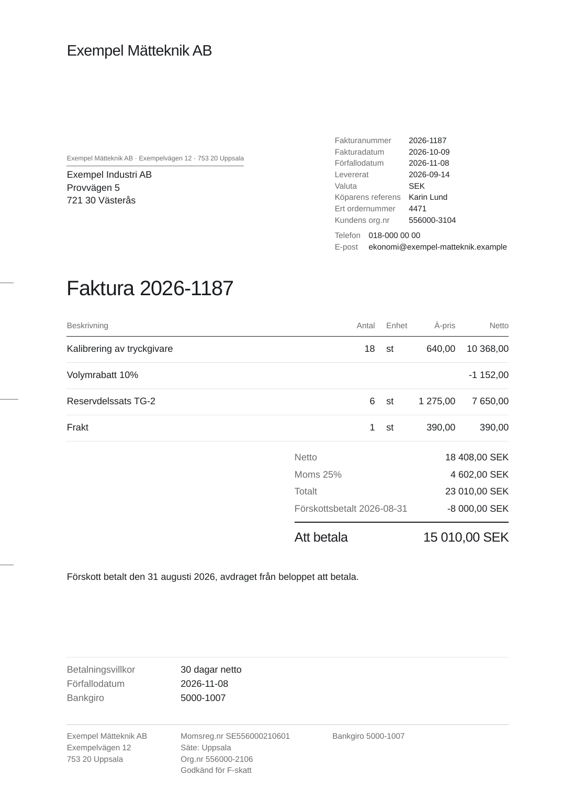
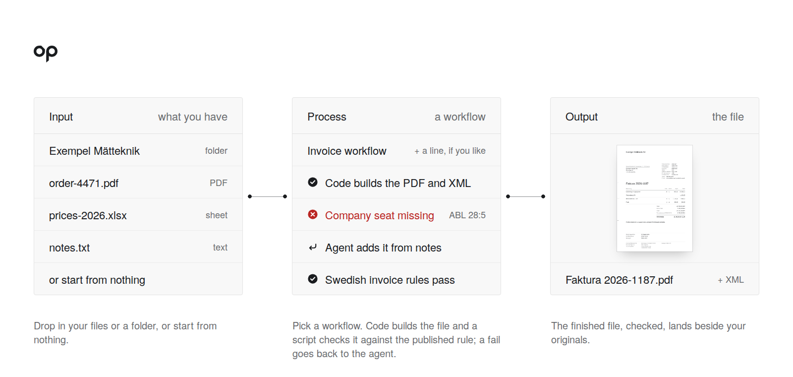
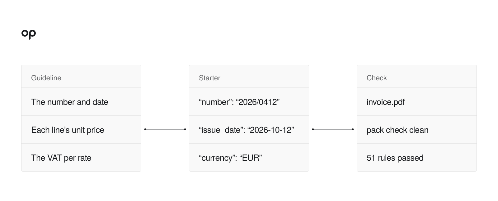
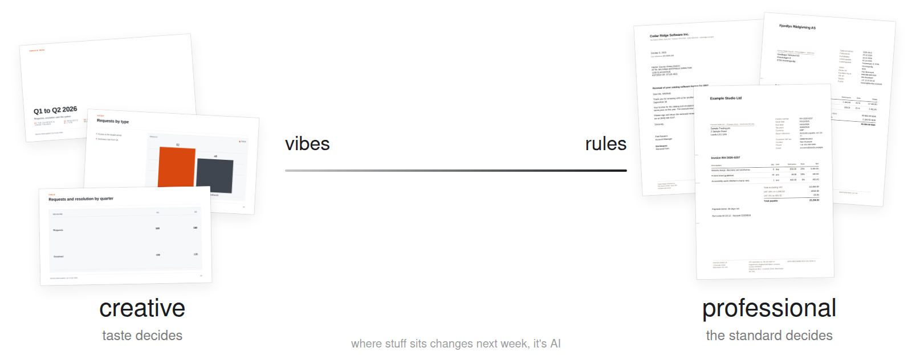

<p align="center">
  
</p>

<p align="center">Finished, checked paperwork from the agent you already have: Claude, ChatGPT, Cursor, Antigravity and more.</p>

<p align="center">
  <a href="#quickstart">Quickstart</a> ·
    <a href="#how-it-works">How it works</a> ·
  <a href="#the-library">The library</a> ·
    <a href="#contribute">Contribute</a>
</p>

Ask the agent you already have for an invoice, an NDA or the board minutes. The library holds
the published rules for that document: your agent writes the content, the library builds the page
and has a scripted check for it, and a fail goes back to the agent with the reason. Open source, Apache 2.0.

> [!WARNING]
> OpenPaperwork is an early preview. Its workflows run inside the agent you already have, with that agent's permissions: it reads the folder you point it at, writes files and runs commands. Each file is checked before it is handed back, but the checks do not catch everything, so read a file before you send it, and keep a copy of the folder. It will grow from here; issues are welcome.

<table>
<tr>
<td width="50%" valign="top" align="center">
<br>
<b>Before.</b> A plain note, typed as it came.
</td>
<td width="50%" valign="top" align="center">
<br>
<b>After.</b> <code>/openpaperwork:invoice</code>: the invoice as PDF, with its XML file.
</td>
</tr>
</table>

<p align="center"><sub>A real run in Claude Code on Claude Haiku: 72 seconds, pack check clean, 51 rules passed. Invented names and numbers.</sub></p>

## Quickstart

**One line.** In the folder that holds your notes, order or data:

```sh
npx skills add ActuallyNodejam/openpaperwork
```

Then ask your agent for the file, in that folder, in your own words. The packs are plain
[Agent Skills](https://agentskills.io): a `SKILL.md`, the scripts that build the file, and the
check. Any agent that reads skills and can run Python uses them as they are.

**The Claude app.** Open Customize > Plugins > Add marketplace, enter
`ActuallyNodejam/openpaperwork`, and install `openpaperwork`. Then start a chat, add your notes or
your folder, and ask.

**The ChatGPT app.** Run the line above in your folder, then open the folder as a project in
ChatGPT's Work mode and ask. ChatGPT finds the skill by itself.

**Cursor and Antigravity.** Run the line above in your folder, open the folder, and ask in the
agent panel.

**Claude Code**, from inside Claude Code:

```text
/plugin marketplace add ActuallyNodejam/openpaperwork
/plugin install openpaperwork
```

`openpaperwork` is the whole library. To keep the list short, install one department instead:
`openpaperwork-finance`, `-sales`, `-legal`, `-hr`, `-operations`, `-marketing`, `-engineering`,
`-academic` or `-formats`. On first use a plugin sets its own Python
up: it installs its packages and Chromium once, into the plugin's own data folder, and prints any
line that needs `sudo` (poppler's `pdftotext`; on Linux the libraries Chromium needs). Codex can
add this repository as a plugin marketplace too
(`codex plugin marketplace add ActuallyNodejam/openpaperwork`).

**Python, once.** Outside the plugins, the packs' scripts need Python 3.10 or later and a few
packages. From a clone of this repository:

```sh
sh portable-pack/install.sh
sh portable-pack/doctor.sh --fix
. .venv/bin/activate
```

The doctor makes `.venv`, installs the packages and Chromium into it, and prints any line that
needs `sudo` for you to run. Run it again until it says `Ready`. The same steps by hand:
[Before you start](docs/community-preview/PORTABLE_PACK.md#before-you-start).

**Or let your agent do it.** Paste this into the agent you already have, in any folder:

```text
Install OpenPaperwork on my computer and make the sample invoice from the notes case. Follow the steps in https://github.com/ActuallyNodejam/openpaperwork/blob/main/START.md
```

The agent follows [START.md](START.md): it adds the plugin or the skills, sets Python up, makes the
sample invoice from the plain note in the pictures above, and ends on `pack check clean`.

**Ask for the file** as you usually do, or start a workflow by its command:
`/openpaperwork:invoice`, alone or with one line after it. A workflow runs in one go, hands
back the file and says what is still open for you. A clean run ends with `pack check clean`. What
each pack covers and what to expect: [Use the packs in your agent](docs/community-preview/PORTABLE_PACK.md).

## Use the agent you already have

<table>
<tr>
<th width="220">Claude</th>
<th width="220">ChatGPT</th>
<th width="220">Cursor</th>
<th width="220">Antigravity</th>
</tr>
<tr>
<td align="center">plugin</td>
<td align="center">skills, in Work mode</td>
<td align="center">skills</td>
<td align="center">skills</td>
</tr>
</table>

Each made the sample invoice above from the plain note, and each run ended on a clean pack check.
In the Claude app and Claude Code the plugin runs the check before the turn ends. With skills
alone, the agent runs the check because the skill asks it to; nothing forces it. For Codex,
`portable-pack/install.sh` also writes a hook that does.

Each agent signs in and bills through its own account (your plan or your API key), under its
maker's terms; OpenPaperwork never sees or stores those credentials. Install and sign-in for each:
[Bring your own agent](docs/community-preview/BRING_YOUR_OWN_AGENT.md).

The agent works inside the folder you open, reads it, writes files and runs commands there under
its own permission settings. So pick the folder for the job, not your whole home folder.

<sub>Claude, ChatGPT, Cursor and Antigravity are their makers' products and trademarks.
OpenPaperwork is not affiliated with or endorsed by them.</sub>

## How it works

What you have goes in, a workflow runs and a script checks the file, and the checked file comes out.

<p align="center">
  
</p>

<p align="center">
  
</p>

- **The library is the product.** Its 91 standards, laws and style guides each have a guideline with a named source, a
  scripted check, a starter and invented cases. The core set ships first and grows by demand, one
  file kind or country at a time. See [Why standards](docs/community-preview/STANDARDS.md).
- **Code does every step with a right answer; the model reads the mess, writes the words and picks.** Figures, units, dates
  and identifiers are read from the person's own file, so a wrong total or a missing unit cannot
  reach the page.
- **The check is the finish line.** The packs that make a file ship a check; the tools that read
  or search (literature search, the Zotero library, the WhatsApp export reader, PDF reading) have
  none. The pack's own instructions tell the agent to run the check on the files the turn wrote.
  A fail names the rule and the evidence and goes back to the agent in the same chat, so it fixes
  what it names, three tries at most. A turn that still fails says plainly what failed.
- **Your files and formats.** The finished file lands beside your originals, in the format you
  already use, and a change is one more ask in plain words.
- **Your agent, any model.** The rules and the check are the same whichever agent or model writes
  the content, so the files come out consistent.

If you have seen Anthropic's knowledge-work-plugins, those are prompts that guide the agent. Here
scripts build the file and a check decides when it is done.

A passing check means the file meets the rules we took from a named source and version. It is not
certification, and it is not legal, tax or accounting advice.

## Why

Knowledge work is mostly files with rules somebody already wrote: invoices, papers, reports,
decks, differing by country. OpenPaperwork keeps those rules as a library the agent reads
before it writes.

<p align="center"></p>

### Measured

The case in the pictures above, five runs each in Claude Code on Claude Haiku 5.5 on 2026-10-31, judged by
the Mustang validator (EN 16931 and PDF/A-3) and the amount due. One case, five runs each. It checks the
claim; it is not a benchmark.

| | The agent alone | With OpenPaperwork |
| --- | --- | --- |
| Valid e-invoice | 2 of 5 | 5 of 5 |
| Right amount due (15,010 kr) | 5 of 5 | 5 of 5 |
| Median time | 142 s | 92 s |

Every file sits somewhere between vibes and rules. On the rules end, somebody already wrote down
what good looks like, EN 16931 for an invoice or APA 7 for a paper. A pack turns that standard into
a scripted check, and every agent and every model meets the same rules and the same check. On the
vibes end, good is taste. The check keeps the floor (nothing overflows, the fonts load, the images
open) and your eye decides the rest.

So we start on the rules end, where a check can do the judging, and every new check moves a bit
more of the line from taste to rules. That is the whole bet: consistent files that pass the
rules we took from the standard, from the library and its checks, whichever agent or model writes them.

Nothing in the library should be invented. A standard names its source and its version, keeps its
licence, and brings four things: a guideline, a scripted check, a starter, and at least three
invented cases that prove the check catches the faults. Adding the next one is a small, reviewable
change, which is why the set can grow by demand. Not every pack is there yet: some pages are
still our own layout while their published one is ported. [Where each pack stands](docs/community-preview/STANDARDS.md#where-each-pack-stands)
says which.

## The library

Led by the document, each document's countries folded beneath it. Each pack's sources, and which of
them settle the page as well as the content:
[Where each pack stands](docs/community-preview/STANDARDS.md#where-each-pack-stands).

| Document | The countries and rules beneath it |
| --- | --- |
| **Invoice**, its credit note, pro forma and tax invoice | EN 16931 e-invoices and credit notes as Factur-X / ZUGFeRD PDFs: France (facture, facture d'avoir, the reform's mentions), Germany (ZUGFeRD, XRechnung); Peppol BIS 3 for Norway (EHF), Denmark, Finland (and Finvoice), the UK, Belgium (Dutch, French and German), the Netherlands (and SI-UBL 2.0), Austria (and ebInterface) and Ireland; the national files of Spain (Facturae 3.2.2, unsigned), Italy (FatturaPA) and Poland (the KSeF structure FA(3)), each beside its page and none of them sent; tax invoices for Australia, Canada (English and French) and the US; on each, the particulars the seller's own company statute puts on an invoice, with a missing one failing the check |
| **Annual accounts** | Sweden (K2) |
| **Quotation**, **order confirmation**, **delivery note**, **purchase order** | Sweden, Denmark, Norway, Finland, Germany, Austria, the Netherlands, Belgium (Dutch and French), Spain, Italy, Poland, the UK, Ireland, the US, Canada (English and French), Australia, each with the company details its own law asks for |
| **Agreement** | NDA, DPA, cloud service, with review and tracked-change redlines |
| **Employment terms** | EU, UK, Sweden, Norway, Denmark, Finland, Belgium in Dutch and French, the Netherlands, Austria, Ireland, Spain, Italy, Poland, Canada and Ontario, Australia; a US offer letter |
| **Letter** | Germany (DIN 5008), Sweden (the same layout), Norway, Denmark, Finland, the US, the UK, Canada (English and French), Australia, Belgium (Dutch and French), the Netherlands, Austria, Ireland, Spain, Italy and Poland |
| **Minutes** | Meeting minutes and company board and general-meeting minutes for Sweden, Norway, Denmark, Finland, the UK, the US, Canada, Australia, Belgium, the Netherlands, Austria, Ireland, Spain, Italy and Poland |
| **Diagram** | Diagrams from a folder's own words, judged by the floor every file meets |
| **Chat log** | WhatsApp chats read into decisions, dates and files |
| **Deck** | Business decks handed back as a PDF, to consulting structure, with an editable PowerPoint file (native charts and tables) when asked |
| **Poster** | Fair and event posters from a folder's own words and marks |
| **Requirements spec** | Requirements specifications with SI units |
| **Paper** | IEEE and ACM papers; APA 7, IEEE and Vancouver references; literature search |
| **Any format** | Reading and writing the formats people already use, and the floor every file meets |

Each workflow is started by its command, typed as `/openpaperwork:<command>` in Claude Code
(`/openpaperwork-<department>:<command>` with a department plugin); each plugin's README says what each workflow
takes and gives.

| Department | Workflows |
| --- | --- |
| Finance | `annual-report`, `invoice`, `credit-note` |
| Sales | `quotation`, `order-confirmation`, `delivery-note`, `proforma-invoice`, `purchase-order` |
| Legal | `draft-agreement`, `review-agreement` |
| HR | `employment-terms` |
| Operations | `letter`, `diagram`, `minutes` |
| Marketing | `deck`, `poster` |
| Engineering | `requirements` |
| Academic | `references`, `paper` |
| Formats | `fill-template`, `brand-deck` |

## No agent in this repository

The library rides the agent you already have; it has no app, agent or account of its own. To set
up a clone with an agent's help, open this repository in your agent and paste:

```text
Read AGENTS.md and set up OpenPaperwork on this computer. Never ask me to paste an API key into the chat.
```

The agent follows [AGENTS.md](AGENTS.md): it checks Python, links the packs, sets their Python up
and checks which agent you use.

## Who builds it

OpenPaperwork is built by [Nodejam](https://nodejam.com). Nodejam Work is set up around a
company's people, files and way of working; company sign-in, roles and admin are being developed.

## Contribute

Bring a small, concrete improvement. Fix an incorrect total. Make a document readable. Fix a print
layout. Add a public-safe example. Remove a setup step. Show what the person needed and what
changed.

Know a standard well, such as your country's invoice, your university's thesis format or a
citation style? That is the most useful thing to bring. A pack is a guideline with a named source,
a scripted check, a starter and at least three cases, and
[Add a standard](docs/community-preview/ADD_A_STANDARD.md) walks through all four. Checks live in
`standards/checks`, cases in `standards/cases`.

Read [CONTRIBUTING](CONTRIBUTING.md), the [code of conduct](CODE_OF_CONDUCT.md) and
[first contribution ideas](docs/community-preview/FIRST_CONTRIBUTIONS.md). The checks use
Python 3.10+ and its standard library, and need no account to prepare a case or check an output.

<table>
<tr>
<th width="330" align="left">Area</th>
<th width="620" align="left">Purpose</th>
</tr>
<tr>
<td><code>skills</code></td>
<td>Reusable ways to make and revise files, and the pack checks in <code>skills/_checks</code></td>
</tr>
<tr>
<td><code>portable-pack</code></td>
<td>The whole library as one plugin and skills folder for other agents; <code>plugins</code> holds one per department</td>
</tr>
<tr>
<td><code>standards</code></td>
<td>The library's standards: guidelines, invented cases and the scripted checks</td>
</tr>
<tr>
<td><code>docs/community-preview</code></td>
<td>Philosophy, standards and contribution guidance</td>
</tr>
</table>

## Progress and credit

[Philosophy](docs/community-preview/PHILOSOPHY.md) ·
[Why standards](docs/community-preview/STANDARDS.md) ·
[Roadmap](docs/community-preview/ROADMAP.md) ·
[Attribution](THIRD_PARTY.md)

Every component OpenPaperwork builds on, its licence and its imported notices are listed in
[THIRD_PARTY.md](THIRD_PARTY.md) and [licenses](licenses).
Sources of inspiration and copied components are told apart in
[credits](docs/community-preview/CREDITS.md).

The Apache 2.0 licence covers the code and the library, except the parts listed in
[THIRD_PARTY.md](THIRD_PARTY.md), which keep their own licences. It does not cover the OpenPaperwork and
Nodejam names and marks: [TRADEMARKS.md](TRADEMARKS.md) says what you may do with them.

Translations are welcome: translate this file and open a pull request that names the language and
the revision translated.
