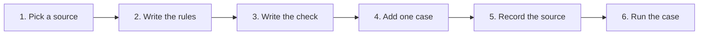

# Add a standard

Read [Why standards](STANDARDS.md) first, and open an issue with the source before you build, so two
people do not add the same standard.

You do not need to touch any agent. A standard is a few small
files under `standards`, and the checks use Python 3.10+ with the
standard library.

The library covers the files any company, school or engineering team makes: business, sales,
finance, engineering and academic work, done in depth. A file only one industry makes is out of
scope here.



## 1. Pick a source

Choose something published, versioned and specific. "Swedish invoices" is not
a source. "Peppol BIS Billing 3.0", with the release you read, is.

- Name the issuer, the version and the date you read it.
- Say what it covers. A university's thesis guide is not a rule for its
  country.
- Check that you may describe it. Most standards may be explained and
  implemented freely but not copied. Cite rule identifiers and write the rule
  in your own words. Copy text only when the licence allows it (MIT, Apache,
  CC BY, the Open Government Licence or the public domain), and say so. A paid
  standard is cited by clause, never pasted. CC BY-SA, CC BY-ND and AGPL text
  is learnt from, never copied.
- Write the rules as a drafting check. A pack never tells the person the file
  is certified or legally sound, never gives legal, tax or accounting advice,
  and never fills in a choice that is theirs to make, such as the governing
  law of a contract.

## 2. Write the rules

Create `standards/guidelines/<issuer>/<version>/guidelines.json`. The
European invoice set is a good one to copy:

```json
{
  "issuer": "cen-en16931",
  "version": "2017",
  "date": "2026-10-03",
  "status": "draft",
  "source": "EN 16931-1:2017 ... Rule identifiers are cited; no standard text is copied.",
  "rules": [
    {
      "id": "EINV-TOTALS",
      "grader": "script",
      "text": "The totals without VAT, of VAT and with VAT are stated and correct."
    }
  ]
}
```

A good rule is one sentence that is true or false of a finished file. Before
you write it, write down the failure it should catch. Five rules that catch
real failures beat thirty that restate the source.

Each rule names its grader.

| Grader | Decided by | Use it for |
| --- | --- | --- |
| `script` | Your function in `checks/` | Anything a program can read from the file |
| `check` | The built-in mechanical checks in `run.py` | Required files, valid package, editable text |
| `render` | LibreOffice page count | Page limits |
| `recalc` | LibreOffice recalculating an edited copy | Live formulas |
| `judge` | A reviewer reading extracted content: a person, or a model you run yourself | A checkable claim a script cannot reach |
| `visual` | A person. Listed, never decided by a script | Taste |

Prefer `script`. Reach for `judge` last.

## 3. Write the check

Add a file in `standards/checks/` with one entry point:

```python
def check(rule_id, path, case, stage):
    """Return (passed, evidence). passed is None when a needed tool is absent."""
```

`path` is the finished file, `case` is the case's `case.json`, and `stage` is
`first` or `revision`. Return a short piece of evidence either way, such as
the cell, page or field you looked at. Read
[`checks/einvoice.py`](../../standards/checks/einvoice.py) for a
complete example.

Keep to the standard library where you can. If a rule needs an outside
validator, run it as a separate optional tool and return `None` when it is
missing, so the rule is skipped instead of failed.

### Show that it fails

A check that passes every file proves nothing. For a pack with a starter, add it to
[`standards/planted/faults.json`](../../standards/planted/faults.json): the starter, the builder, and for
each script rule one fault, a sentence the file loses or a number it gets wrong, with the rule it should
fail. `python3 standards/planted/make.py --pack <pack>` builds the clean file and each faulty one, and
stops when a fault does not fail the rule you named. CI's pack grade then shows, on every pull request,
that the clean file passes and every planted fault fails. `python3 standards/test_planted.py --coverage`
lists the rules no planted fault trips yet.

## 4. Add one case

A case is an invented task a real person might have. It lives under
`cases/<sector>/<occupation>/<task>/` with:

| File | Holds |
| --- | --- |
| `request.md` | The ask, in the person's own words |
| `revision.md` | One change to make in the same chat |
| `inputs/` | The files they start with. Invented data only |
| `case.json` | The facts a correct answer contains, and the criteria |

Criteria cite your rules as `<issuer>/<version>#<ID>`, for example
`cen-en16931/2017#EINV-TOTALS`. Add the case to `catalogue.json`.

Use invented names, numbers and companies. Never a real customer's file.

## 5. Record the source

Add a row to [`standards/SOURCES.md`](../../standards/SOURCES.md)
with the licence as you read it, the version you pinned, and whether anything
was copied, adapted or only consulted. If you copied text or code, it also
needs a row in `THIRD_PARTY.md` and its licence under `licenses/`.

## 6. Run the case

Run the case before and after your change and report both, with the agent and
model you used. Passes per rule are enough. One task is a small sample and it
is fine to say so.

A starter file is optional and often the largest gain. If the layout can be
decided in a template or a create script under `skills/`, the model no longer
has to decide it.

A pack under `skills/` says in its `pack.json` what it hands back and the
command that checks it, for example
`"check": "python3 {here}/../_checks/packcheck.py e-invoice {file}"`: `{here}`
is the pack's folder and `{file}` one finished file, so the check runs once
for each file. A check that judges a whole folder, such as a set of posters,
names `{folder}` in place of `{file}` and runs once for each folder those
files are in.

## Standards we would like

None of these is started. Open an issue before you begin, and say which source you will use.
[PACKS.md](../../standards/PACKS.md) lists what is already in.

| Family | Standard | Why it matters |
| --- | --- | --- |
| Business | A national invoice for a country not yet in | Required fields and tax wording change at every border; the e-invoice pack covers 17 countries today |
| Business | Board papers, and minutes for further countries' companies | Each country's company law adds its own contents |
| Legal | A country's statutory contents for an employment contract or a power of attorney | The drafting check reads structure; the required contents come from each law |
| Academic | Further citation styles through CSL: Harvard, Chicago, MLA | APA 7, IEEE and Vancouver are in. The style files are openly licensed |
| Academic | A thesis format from your university | Each one is a small, well-specified pack |
| Academic | Further journal and conference templates | Two columns, margins, reference format |
| Creative | Good practice for a poster or a one-page flyer | Makes part of a taste judgment checkable |
| Creative | Slide readability beyond the floor | Density, hierarchy, one idea per slide |
| Any | Accessible HTML output | A tool is identified in SOURCES.md and not yet used |

If your standard is not on the list, that is the better reason to add it.
