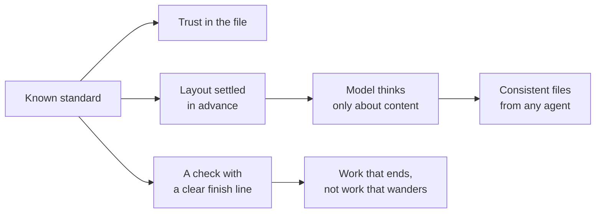
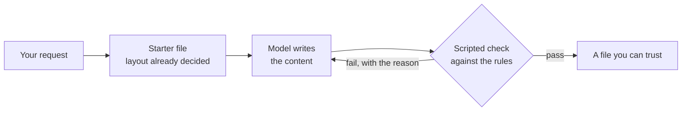
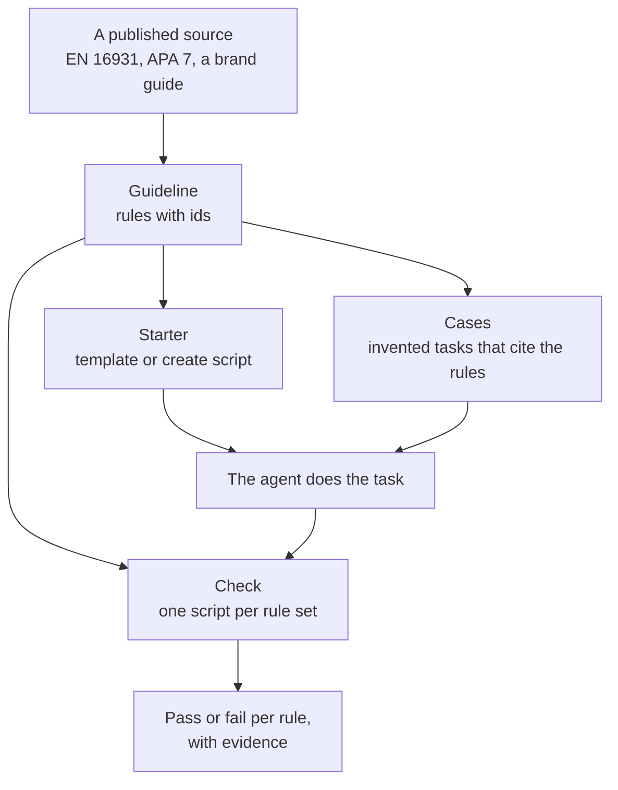
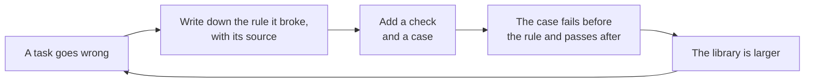

# Why standards

Most office work is a file with rules somebody already wrote down. An invoice
has required fields and a VAT calculation. A journal paper has a citation
style and a column layout. A company deck has a palette, two fonts and a
footer. People do not invent these each time. They follow them.

OpenPaperwork keeps those rules in a library and lets any agent follow
them too. This page explains why we think that is the right way to make files
with an agent, and where it stops working.

## The idea in four lines

1. A file is trusted when it follows a standard people already know.
2. Where the standard settles the layout too, the model only has to think
   about content.
3. The same rules and the same check apply to every agent and model.
4. The check is a finish line, so the work ends when it is right.

## We do not invent standards

We collect the ones the world already agreed on and make them checkable. The
European Union decided what a valid invoice contains. The APA decided how a
reference is written. Your company decided its fonts and colours. None of
that is our opinion, and none of it should be.

This matters for trust. An accountant accepts an invoice because it follows
EN 16931, not because of which model wrote it. A reviewer accepts a paper's
references because they follow the journal's style. When a file conforms to
a standard its reader already knows, the reader does not have to trust the
model at all.

## Productive means finished

Work is activity. Productivity is a finished result that meets the goal. An
agent can search, read, plan and rewrite for an hour and hand back nothing
you can use, and all of it looks like work.

A standard gives the task a finish line. The check says done or not done,
and names the rule that failed. The agent stops when the file is right and
does not wander past it. That is what we mean by the name.

## The intuition

Give a capable person a blank page and ask for an invoice, and they will
spend most of their effort on things that are not the invoice: where the
totals go, which fields the law needs, what the tax line should say. Give the
same person the right form and they finish in minutes, because only the
content is left.

A model is in the same position. Asked for a file with no guidance, it has to
work out four things at once, every single time.

With a standard, three of those four are settled before the model writes a
word, and a script reads the result afterwards.

The second road asks less of the model. That is the whole idea. The less the
model has to figure out, the less the result depends on which model wrote it,
and the more alike the files come out.

## What a standard is here

A standard in this repository is a pack with three parts.

| Part | What it is | Where it lives |
| --- | --- | --- |
| Guideline | The rules in plain sentences, each with an id, tied to a named source and version | `standards/guidelines/<issuer>/<version>/guidelines.json` |
| Check | A script that reads a finished file and decides each rule | `standards/checks/` |
| Starter | A template or a create script, so the layout is decided up front | `skills/<kind>/templates` and `skills/<kind>/scripts` |

A rule is one sentence a script can decide. From the European invoice pack:

> EINV-VAT. The VAT breakdown has one entry per category and rate, with VAT
> calculated on the sum of that group's line nets.

Nothing in that sentence needs intelligence to verify. It needs arithmetic.

## Where it applies

Wherever someone has already written the rules.

| Family | Examples | In the library today |
| --- | --- | --- |
| Business | Invoices, credit notes, quotes, purchase orders, letters, minutes, spreadsheets, employment statements, annual reports, reports | The every-file floor; invoices and credit notes on each country's own rules (EN 16931 with the XRechnung rules, Peppol BIS 3, Factur-X, the national invoice laws) and the particulars a company's statute puts on them; quotations, order confirmations, delivery notes, pro forma invoices and purchase orders (UBL 2.1, Incoterms 2020) on the sender's country letter layout; business letters (DIN 5008, or the envelope window of the sender's country); the written statement of employment terms (Directive (EU) 2019/1152 and each country's own law); the annual report of a smaller Swedish company (årsredovisningslagen and Directive 2013/34/EU, K2 cited); board and general-meeting minutes on each company statute, and Robert's Rules; spreadsheets (the UK government spreadsheet rules and the FAST Standard) |
| Academic | Papers, theses, grant proposals, reference lists, clinical audits and nursing essays | APA 7, IEEE, Vancouver for medicine and health sciences, the IEEE and ACM conference formats, one university thesis guide, Horizon Europe Part B |
| Engineering | Requirements specifications, technical reports | NASA SE Handbook Appendix C for requirements, the SI Brochure and NIST SP 811 for units |
| Legal | NDAs, data processing agreements, cloud service agreements, reviews of the other side's paper, redlines | Common Paper's standard terms as the clause base; the NDA and DPA review checklists from mike-workflows, one verdict per item with every finding quoted; tracked changes in their own file; GDPR Article 28(3). Never the merits, never advice |
| Creative | Decks, brand material, posters | Business decks as a PDF, with an editable PowerPoint file when asked (a message as every title, the storyline, a source under every chart, honest charts, every bound a number in a density preset); decks from a brand kit (ratio, fonts, palette, minimum size, footer); a fair poster has a fixed layout and a check of its own, and no published standard |

Creative work is the interesting case. It looks uncheckable, and part of it
is. But a brand guide is a standard. So is good practice for a poster or a
slide. Each rule we can write down moves a little more of the work from taste
to fact, and a person's eye is kept for what is left.

Country is the other axis. An invoice, a tender reply and a thesis all change
at the border. The folder shape is `guidelines/<issuer>/<version>`, so a
national rule set is one more folder. The library carries country rules for 17
countries today: Australia, Austria, Belgium, Canada, Denmark, Finland, France,
Germany, Ireland, Italy, the Netherlands, Norway, Poland, Spain, Sweden, the
United Kingdom and the United States, though not every kind of file in each
(the tables below say which). A contributor is most useful with a country not
on that list, or with a kind of file that has a published standard and no pack
here yet.

## How it grows

The library is not designed up front. It grows from misses.

Every round leaves a rule with its source, a check and a case behind. Whatever
agent or model comes next meets all of them on the first day.

## Where each pack stands

A file has two halves: what it says and how it looks. Some standards settle both, others only the
content, and then the page is our own design until a published layout is ported. This table says
which is which, so nothing here passes for a standard that is really taste.

### Finance

| Pack | Content from | Page from | Status |
| --- | --- | --- | --- |
| EU invoice | EN 16931-1:2017 for the data, VAT Directive 2006/112/EC Art. 226, 226(11a) and 230 for what the page must say | The seller country's letter layout where the letter pack has one (the buyer alone in that country's envelope window), else DIN 5008:2020 Form B; the buyer's address as the letter to the same buyer writes it, the way its post office reads it; the invoice data inside the text's right edge, the one the table ends on; CLDR for numbers and dates | Both halves sourced, checked by `EINV-PAGE-DIN5008` and `EINV-PAGE-MENTIONS`. Words for German, English, Swedish, Danish, Norwegian, Finnish, French, Dutch, Spanish, Italian and Polish; other languages read English. Handed back as one Factur-X / ZUGFeRD 2 PDF/A-3 with the XML inside (`EINV-FACTURX`), checked by veraPDF (`EINV-PDFA`) and the KoSIT validator (`EINV-KOSIT`) where installed |
| French invoice and facture d'avoir | CGI annexe II art. 242 nonies A, with the reform's mentions for invoices from 1 September 2026; Code de commerce L441-9, L441-10 and D441-5; service-public.fr F31808 (Légifrance and impots.gouv.fr content under Licence Ouverte 2.0); the BR-FR rules of FNFE-MPE France_RFE (Apache-2.0) for AFNOR XP Z12-012 | DIN 5008:2020 Form B as the other invoices, CLDR fr for numbers and dates (2 970,00 €, 15/09/2026); the French letter layout NF Z11-001 is not ported | Checked by the `FR-` rules and `EINV-FR-CTC`. It never says an invoice is lawful or that a platform will accept it |
| Nordic invoices and credit notes | Norway: bokføringsforskriften §§ 5-1-1 to 5-1-5 (org.nr. with MVA, Foretaksregisteret, time and place of delivery, VAT in NOK); Denmark: momsbekendtgørelsen § 58; Finland: arvonlisäverolaki 209 e § (all free of copyright); Peppol BIS Billing 3.0 with the NO-R and DK-R rules for the XML (EHF in Norway; Denmark's OIOUBL 3.0 was dropped for a Peppol-based format in 2026); Finvoice 3.0 (Finanssiala, freely usable) on request | Each country's letter layout (C5/E65 windows in Norway and Denmark, the SFS 2487 address field in Finland), CLDR nb, da and fi for numbers and dates; the Finnish bank barcode (Finanssiala, version 4) | Checked by `NO-SELLER`, `NO-CONTENT`, `DK-INVOICE`, `FI-INVOICE`, `FI-PAYMENT`; the official Peppol rules (`EINV-PEPPOL`) and Finvoice schema (`EINV-FINVOICE`) run untouched where installed. Peppol's rules are cited, never copied |
| UK VAT invoice | HMRC VAT Notice 700/21 section 4.1 (OGL v3): every line's rate, the tax point, the VAT in sterling; a company's registered name (SI 2015/17 reg. 24; the number and the registered office are asked on letters, order forms and websites only, reg. 25) | The UK letter layout (DL window), CLDR en-GB | Checked by `UK-VAT-INVOICE`; Peppol BIS 3.0 UBL beside the page (`EINV-PEPPOL`) |
| Belgian invoice and credit note (Dutch, French, German) | Royal Decree no. 1 art. 5 § 1 (9°bis: the one reverse-charge mention per language, "Btw verlegd", "Autoliquidation"), art. 12 § 3 (a credit note refers to its invoice) and art. 13ter (Peppol BIS UBL between Belgian businesses since 1 January 2026); Code of companies and associations art. 2:20; the Flemish decree of 19 July 1973 art. 5 (Dutch at home, a second valid version only for a customer in another EU or EEA state); all free of copyright | The Belgian letter layout (the buyer in the window on the right, where bpost's zones put it); CLDR nl-BE, fr-BE and de-BE; the structured communication +++123/4567/89012+++ | Checked by `BE-INVOICE`; the official Peppol rules (`EINV-PEPPOL`) run untouched where installed. No official German text of the mention was read, so the German page writes the VAT Directive's |
| Dutch invoice and credit note | Wet op de omzetbelasting 1968 art. 35a (lid 1 m: «btw verlegd») and art. 34f; Handelsregisterwet 2007 art. 27 for the KvK number (free of copyright); Peppol BIS Billing 3.0 with the NL-R rules, or SI-UBL 2.0, the NLCIUS (MIT), on request | The Dutch letter layout (window on the left); CLDR nl | Checked by `NL-INVOICE`; `EINV-PEPPOL` or `EINV-SI-UBL` run the official rules untouched where installed |
| Austrian Rechnung and Rechnungskorrektur | Umsatzsteuergesetz 1994 § 11 (the recipient's UID over 10 000 euros, Abs. 1 Z 3 lit. b; a reverse-charge note in no fixed words, Abs. 1a), the ministry's UID check digit, UGB § 14 (free works, UrhG § 7); Peppol BIS Billing 3.0, or ebInterface 6.1 on request (cited, run untouched; no licence stated) | The Austrian letter layout (DIN lang or C6/5 window); CLDR de-AT | Checked by `AT-INVOICE`; `EINV-PEPPOL` or `EINV-EBINTERFACE` where installed. The federal portal takes ebInterface and Peppol UBL, not CII |
| Irish VAT invoice and credit note | VAT Consolidation Act 2010 ss. 66, 67 and VAT Regulations 2010 reg. 20; Revenue's two pages on what an invoice and a credit note state (CC BY 4.0) | The Irish letter layout (DL window); CLDR en-IE | Checked by `IE-VAT-INVOICE` (any clear note that a reverse charge applies passes: the law fixes no words); Peppol BIS 3.0 UBL beside the page (`EINV-PEPPOL`). Ireland's own e-invoicing duty starts in phases from November 2028 |
| Spanish factura and factura rectificativa | Reglamento de facturación (Real Decreto 1619/2012) art. 6.1 (m: «inversión del sujeto pasivo») and art. 15 (a rectifying invoice in a series of its own, naming its invoice, stating the rectification with its sign); the NIF's form from Real Decreto 1065/2007 and Orden EHA/451/2008 (not objects of intellectual property, LPI art. 13); Facturae 3.2.2 for the file (reuse with the source named) | The Spanish letter layout (the buyer in the window on the right); CLDR es for dates | Checked by `ES-INVOICE`; `EINV-FACTURAE` runs the official schema where installed. The Facturae is written unsigned: FACe takes it only with an XAdES signature, which the library does not make. The library is no VERI\*FACTU system (Real Decreto 1007/2023, due 1 January and 1 July 2027) and its page carries no QR code |
| Italian fattura and nota di credito | DPR 633/1972 art. 21 comma 2 and 6, art. 17 («inversione contabile»), art. 17-ter and art. 26, in force until 31 December 2026, and the Testo unico IVA (D.Lgs. 10/2026) art. 72, 64, 65 and 92 from 1 January 2027; DM 17 giugno 2014 art. 6 for the stamp-duty annotation (official acts, legge 633/1941 art. 5); FatturaPA schema 1.2.3 for the file (cited, run untouched; the site reserves all rights) | The Italian letter layout (the buyer in the window on the right); CLDR it for dates | Checked by `IT-INVOICE`; `EINV-FATTURAPA` runs the official schema where installed. The file is not sent: an invoice between parties in Italy exists once the Sistema di Interscambio has taken it, and the page is a courtesy copy. The library never chooses a regime fiscale or a Natura, and never decides whether stamp duty is due |
| Polish faktura and faktura korygująca | Ustawa o VAT art. 106e ust. 1 («odwrotne obciążenie», «mechanizm podzielonej płatności», «metoda kasowa»; the tax in złoty, ust. 11) and art. 106j ust. 2 (a correcting invoice names its invoice and that invoice's KSeF number and states the correction); art. 106ga and 145l, 145m for the KSeF duty (not objects of copyright, prawo autorskie art. 4); the logical structure FA(3) for the file (an official document) | The Polish letter layout (the buyer in the window on the right); CLDR pl for dates | Checked by `PL-INVOICE`; `EINV-KSEF` runs the Ministry's schema where installed (from a copy with its counts above 100 unbounded; the counts as published on request). The file is not sent to KSeF: it has no KSeF number, and the page carries neither that number nor the code of art. 106gb ust. 5 |
| Australian tax invoice | GST Act 1999 s 29-70 and GST Regulations 2019 s 29-70.01 (CC BY 4.0): Tax invoice, ABN, GST, GST-free lines, the buyer from A$1,000; an adjustment note for a credit (s 29-75) | The Australian letter layout (DL window), CLDR en-AU | Page only, checked by `AU-TAX-INVOICE`; Peppol PINT A-NZ is not built |
| Canadian invoice (English and French) | SOR/91-45 s. 3: the supplier, date and total; from $100 the GST/HST number and each tax; from $500 the buyer and the terms; the QST number in Quebec | The Canadian letter layout on US Letter (#10 window, the invoice data above it), CLDR en-CA and fr-CA | Page only, checked by `CA-GST-HST` |
| US invoice | None: the US has no federal invoice standard and no VAT. Sales tax per jurisdiction, as the order lists it | The US letter layout on US Letter (#10 window, the invoice data above it), CLDR en-US | Our own conventions, said plainly; checked by `US-SALES-TAX` (no VAT wording, the taxes add up) |
| Credit notes | EN 16931 (BT-25, BT-26, BR-55, the BR-CO totals), VAT Directive Art. 219 and 226; the XRechnung rules ported from KoSIT xrechnung-schematron 2.6.0 (Apache-2.0) | DIN 5008:2020 Form B, as the invoice | Checked by the `INV-CREDIT-` rules and `INV-XRECHNUNG`; the KoSIT validator accepts the XRechnung (`EINV-KOSIT`). Peppol BIS is never copied; it may not be modified |
| A company's own particulars on its invoice | The seller's own company statute, read in its official text and enforced only where its words reach an invoice: Code de commerce R123-237 and R123-238 (France), Code of companies and associations art. 2:20 (Belgium), Handelsregisterwet 2007 art. 27 and BW 2:186 (the Netherlands), Código de Comercio art. 24 (Spain), Codice civile art. 2250 (Italy), aktiebolagslagen 28 kap. 5 § (Sweden), bokføringsforskriften § 5-1-2 (Norway), selskabsloven § 2 (Denmark), Corporations Act 2001 s 153 (Australia); the registered name alone in the UK (SI 2015/17 reg. 24), Ireland (Companies Act 2014 s. 49) and Canada (CBCA s. 10(5)). Germany, Austria, Poland and Finland ask for these on business letters and order forms, not invoices, and the US has no federal rule | The footer of the page, in the words each country uses | Checked by `EINV-PARTICULARS`: a missing particular fails with its article; one the order lists as `unknown` is printed nowhere and warns, and the reply must say so; one the person's own files give and the page drops fails. The check reads statutes, it does not say an invoice is lawful |
| Annual accounts | Årsredovisningslagen (1995:1554) 2, 3, 5 and 6 kap. (outside copyright); Directive 2013/34/EU Art. 4, 9, 10, 13, 14 and 16 (EUR-Lex, Decision 2011/833/EU); BFNAR 2016:10 (K2) and 2012:1 (K3), cited only | Our own plain layout, in the order K2 sets out | Checked by the `ANNUAL-` rules: the parts, the unit, last year's figures, the sums, the balance, the year's result, the changes in equity, the disposition, the notes and the signatures. It never says the accounts are correct, lawful or ready to file |

### Sales

| Pack | Content from | Page from | Status |
| --- | --- | --- | --- |
| Trade documents | Incoterms 2020, UBL 2.1 fields; company details from Directive (EU) 2017/1132 Art. 26 (Norway through the EEA) and the country's own rule beside it: Belgium's Code of companies and associations art. 2:20 (the enterprise number with RPR or RPM and the court), the Dutch Handelsregisterwet 2007 art. 27 and BW 2:186 (the KvK number and the seat), Austria's UGB § 14 (the Firmenbuch number and court), Ireland's Companies Act 2014 s.151 (the number, the place of registration and the office; the directors on letters only), Spain's Código de Comercio art. 24 (the domicile and the Registro Mercantil entry; the paid-up capital beside the subscribed when the capital is named), Italy's Codice civile art. 2250 (the seat, the register office and number, the capital as paid up, a sole shareholder), Poland's Kodeks spółek handlowych arts. 206 and 374 (the seat and address, the registry court and KRS number, the NIP and the share capital); an Australian company's ABN or ACN (Corporations Act 2001 s 153) | The letter layout of the country the document is sent from where the letter pack has one (the address in that country's envelope window, as on its invoice and its letter: on the left in the Nordics, the Netherlands, Austria, the UK, Ireland and Australia, on the right in Belgium, Spain, Italy and Poland, a No. 10 window in the United States and Canada), else DIN 5008:2020 Form B (Germany, Sweden, France); A4, or US Letter in the United States and Canada; CLDR for numbers and dates | Both halves sourced, checked by `TRADE-WINDOW` (PDF and Word: the address inside the window and nothing else there, the layout's margins) or `LETTER-DIN5008` on Form B, `LETTER-COMPANY`, `LOCALE-PAPER`, `TRADE-LANG` (every label in the document's language) and `TRADE-BLOCK` (on a PDF the information block ends on the text's right edge, where the table ends, or before a window on the right, with one line per label, as on an invoice page). No operator publishes a window position, only its zone, and nobody has tried a real envelope. The address field is written the way the recipient's post office reads it, through the same code as the letter and the invoice, and so is the sender's own address in the footer. Words for Swedish, Danish, Norwegian, Finnish, German and Austrian German, Dutch and Belgian Dutch, British, Irish, US, Canadian and Australian English, Canadian and Belgian French, Spanish, Italian and Polish, each market's tax by its own name (MVA, ALV, btw, TVA, USt., IVA, sales tax, GST/HST, TPS/TVH, GST); a Belgian seller writes in its region's language. When the files give no register number the script warns with the country's rule and prints none. A workbook is a working sheet, not a letter; it keeps the address on the side the PDF has it. The UN Layout Key covers customs and transport forms, which the pack does not make |
| Purchase orders | OASIS UBL 2.1 Order fields; Incoterms 2020 when goods cross a border | The buyer's country's letter layout or DIN 5008:2020 Form B, as the trade documents | Checked by the `TRADE-PO-` rules |

### Legal

| Pack | Content from | Page from | Status |
| --- | --- | --- | --- |
| Agreements | Common Paper Mutual NDA 1.0, DPA 1.1 and Cloud Service Agreement 2.1 Standard Terms (CC BY 4.0), word for word; the NDA elements and the nda-review and dpa-review checklists from Open Legal Products' mike-workflows (MIT); GDPR Article 28(3) | Common Paper's Cover Page and Standard Terms; a review memo with a coverage table; the other side's own file with tracked changes | By the `LEGAL-` rules: the structure of a draft; one verdict per checklist item and every quote found in their document; real tracked changes with the original otherwise untouched. It never judges the terms, never says an agreement is fine to sign, and gives no legal advice; the governing law is always the parties' choice |

### HR

| Pack | Content from | Page from | Status |
| --- | --- | --- | --- |
| Employment statement | Directive (EU) 2019/1152 Art. 4, 5, 7 and 8; UK Employment Rights Act 1996 ss. 1 to 3 (OGL v3); LAS 6 c § for Sweden; arbeidsmiljøloven § 14-6 for Norway; lov 501/2023 § 3 for Denmark; työsopimuslaki 2:4 § for Finland; Canada Labour Code s. 253.2 and CLSR s. 3.1 (English and French); Ontario O. Reg. 285/01 s. 1.2; the Belgian law of 7 October 2022 arts. 4 to 6, in Dutch or French by region; BW 7:655 for the Netherlands; AVRAG § 2 for Austria's Dienstzettel; the Terms of Employment (Information) Act 1994 s. 3 for Ireland (CC BY 4.0), with its five-day core terms; Spain's Real Decreto 723/2026 (in force 5 October 2026: it transposes the Directive, replaced Real Decreto 1659/1998 and asks for the information before the employment begins); Italy's D.Lgs. 152/1997 art. 1 as in force from 28 June 2026, with the CNEL code of letter q-bis); Poland's Kodeks pracy art. 29, the contract's own terms and the information due within seven days; the Fair Work Act 2009 statements for Australia; for a US offer letter the FLSA overtime rule and the New York 195(1) and California 2810.5 pay notices (New York read on the State Senate's site, California through the Labor Commissioner's own notice template) | Our own plain layout, A4 or US Letter by country | Checked by the `EMPLOY-` rules: which items are there, the dates, probation, pay, work abroad, the language of the headings (in Belgium the region's), what may only be referred to (in Spain, Italy and Poland a pointer to the law or the collective agreement is accepted where the law allows one), the employer's signature where the law asks for one, how a collective agreement is identified in Spain and Italy, and each country's own items. It never says whether a term is lawful and gives no legal advice |

### Operations

| Pack | Content from | Page from | Status |
| --- | --- | --- | --- |
| Business letter | DIN 5008:2020 for the parts of a letter; Directive (EU) 2017/1132 Art. 26 for company details; the salutation and closing of each variant (SECNAV M-5216.5, the Australian Style Manual, the OQLF and Taaladvies.net, cited; for German the Amtliches Regelwerk der deutschen Rechtschreibung 2024, CC BY 4.0); each country's own company details (Belgian companies code art. 2:20, Handelsregisterwet 2007 art. 27, UGB § 14, the Irish Companies Act 2014 s.151, Spain's Código de Comercio art. 24, Italy's Codice civile arts. 2250 and 2497-bis, Poland's Kodeks spółek handlowych arts. 206 and 374); for Spanish the Real Academia Española and for Polish the Poradnia Językowa PWN on the salutation and closing, cited | DIN 5008:2020 Form B in Germany and Sweden; for Norway, Denmark, Finland, the US, the UK, Canada, Australia, Belgium, the Netherlands, Austria, Ireland, Spain, Italy and Poland the envelope window of the sender's country (on the right in Belgium, Spain, Italy and Poland) and the address as the recipient's post office reads it (USPS Publication 28, Royal Mail, Canada Post, Australia Post, Posten, Posti, PostNord, bpost, PostNL, Österreichische Post, An Post, Correos, Poste Italiane, Poczta Polska, cited); CLDR long dates, GOV.UK style (OGL v3); a Finnish letter's page number 1 (2) | Both halves sourced, checked by `LETTER-DIN5008` or `LETTER-WINDOW`, `LETTER-ADDRESS`, `LETTER-DATE`, `LETTER-FORM`, `LETTER-LANGUAGE`, `LETTER-PAGES`, `LETTER-PARTS` and `LETTER-COMPANY`. No operator publishes the position of a window, only the zone it must stay in: each window is a common maker's window inside that zone, and the guideline names per country what was read (the UK on the 90 x 35 mm window only, Finland from 40 mm down, Belgium's rectangle worked out from bpost's zones, Sweden and Denmark not confirmed against a PostNord document; for Spain, Italy and Poland the zone is published and the exact position is not, so the window is the DIN window mirrored to the right inside each zone). The DIN 5008 letter writes its address as the recipient's post office reads it and ends its information block on the text's right edge, as invoices do. No Italian authority's rule for the salutation and closing was found; none is scripted. NBN Z 01-002, NEN 1026, ÖNORM A 1080, SFS 2487 and NS 4129 are paid and were not read; nobody has tried a real envelope |
| Meeting minutes | Robert's Rules of Order Revised (1915) §60; a company's board and general meeting on its statute: aktiebolagslagen 8 kap. 24 §, aksjeloven §§ 6-29 and 5-16, selskabsloven §§ 128 and 101, osakeyhtiölaki 6:6 and 5:23, Companies Act 2006 ss.248-249 and 355-356, DGCL §§ 141-142, CBCA ss.20, 114 and 117, Corporations Act 2001 s.251A; the Belgian companies code arts. 5:75, 5:76, 5:90 and 5:93 with their twins for the CV and the NV, BW 2:230 and 2:120, GmbHG §§ 30g and 40 and AktG § 92, the Irish Companies Act 2014 ss.160, 161, 166 and 199; Spain's Ley de Sociedades de Capital arts. 192, 202, 203 and 250 with the Reglamento del Registro Mercantil arts. 97 to 103, Italy's Codice civile arts. 2371, 2375 and 2479-bis, Poland's Kodeks spółek handlowych arts. 208(1), 222, 248, 376, 391 and 421 | Our own plain layout, in the language of the minutes | Content sourced, checked by the `MINUTES-` rules, `MINUTES-STATUTE` and `MINUTES-SIGNED` per statute, each naming its article; where a statute sets nothing (a Dutch or an Italian board) or asks for a notary (an Austrian AG's general meeting, an Italian extraordinary assembly, a Polish S.A.'s general meeting, a Spanish junta a notary was called to) the check says so and passes nothing. The Spanish register rules bind for entry in the Registro Mercantil only (art. 97.3). Selskabsloven §§ 101 and 128 were read against the four acts amending the law since 2025: unchanged. The page is ours |

### Marketing

| Pack | Content from | Page from | Status |
| --- | --- | --- | --- |
| Business decks | The UK Government Analysis Function's guidance on charts and on tables (OGL v3.0); the Urban Institute Data Visualization Style Guide (Apache-2.0); the US plain language guidelines on headings, Section508.gov on presentations and the CFPB data visualization guidelines (public domain, CC0); WCAG 2.2, cited; IBCS and published consulting decks followed in our own words | One description of the deck, laid out once and written two ways: the PDF that is handed back (pages as HTML, printed by Chromium) and, when asked, an editable PowerPoint file (a master with a layout a page type, native charts and tables); the look is one token file a company replaces, the open default one ink on white | Checked by the `BDECK-` rules on the file itself, a PDF's page rules measured on its printed pages: a message as every title, the storyline, a source under every chart and table, honest and labelled charts, one highlight, tables as tall as their rows, fit, fill, words, type, contrast, grid and accessibility basics, and a 2x2 matrix, a figure, a quote and an appendix of backup pages each under a rule of its own; every bound on how much a page carries is a number in a density preset |
| Decks and posters | A brand kit when there is one | Taste | The floor is checked, the rest is your eye |

### Engineering

| Pack | Content from | Page from | Status |
| --- | --- | --- | --- |
| Requirements specs | NASA SP-2016-6105 Rev 2 Appendix C (public domain); ISO/IEC Directives Part 2 clause 7, cited | Our own plain layout | Checked by the `REQ-` rules: one id each, shall for a requirement, no vague words, an owner and a date on every TBD, a way to verify |
| SI units | The SI Brochure, 9th edition v4.01 (BIPM, CC BY 4.0); NIST SP 811 (public domain) | Tools, not a kind of document | Checked by `UNITS-SPACE` and `UNITS-SYMBOL` in the requirements pack |

### Academic

| Pack | Content from | Page from | Status |
| --- | --- | --- | --- |
| Research paper | IEEE and ACM conference formats | The publisher's own class (IEEEtran, acmart) | Both halves sourced |
| Reference lists | APA Publication Manual 7th ed. (§2.12, §8.4, §9.8 and more, per rule), IEEE Reference Guide 3.28.2025 | Set by the document it sits in | Content sourced per rule; the official CSL files pinned verbatim |
| Vancouver references | NLM Citing Medicine 2nd ed. chapters 1 and 2 and the NLM sample references (public domain); the ICMJE Recommendations IV.A.3.g, cited | Set by the document it sits in | Checked by the `VANC-` rules: order of first citation, one in-text form, the list 1 to n, cited and listed, one number per source, authors, journal full stops, year;volume(issue):pages, online sources. It reads the form, never whether a paper is ready to submit; vancouver.csl was read, not copied |

### Formats

| Pack | Content from | Page from | Status |
| --- | --- | --- | --- |
| Word, Excel, PowerPoint, PDF | The every-file floor: WCAG 2.2 contrast, titles, alternative text and language; PDF/UA-1; defect checks for cut-off text, missing formula results and covered text | Tools, not a kind of document | Each floor rule says whether it is a standard, a defect check or a house convention (two fonts at most is the one convention) |
| Spreadsheets | UK Government Analysis Function, Releasing statistics in spreadsheets (OGL v3); the FAST Standard 02c (CC BY 4.0) | The same rules: no merged or hidden cells, headings, numbers as numbers | Every workbook is checked by the `SHEET-` rules; the rules for published statistics tables are listed but judged, not scripted |

When a page port lands, its row moves up and its layout gets a check, the way the German invoice did.

## What a check cannot do

We would rather say this here than have you find it.

- It cannot judge taste. A check establishes facts about a file. Whether the
  file is persuasive, kind or beautiful is for a reader.
- It is not certification, and it is not legal, tax or accounting advice.
  Passing the invoice rules means the file matches the rules we encoded from
  a named version of a standard. It does not mean your tax authority, your
  court or your auditor accepts it.
- A thin pack is worse than none. Three rules that pass tell you little and
  look like assurance. A pack earns its place when its rules catch real
  failures.
- It only helps where rules exist. For open-ended work with no standard, this
  library is no better placed than any other tool.
- Sources go stale. Every guideline names its source and version so a rule
  can be traced, challenged and updated.

## Why this is open

The rules are public knowledge. A citation style, an invoice standard and a
funding template belong to everyone who has to follow them. What is scarce is
the work of turning them into something a script can check, and that work is
better shared: an accountant in Lisbon knows the Portuguese invoice, and a
doctoral student in Jakarta knows the thesis format.

The packs load in the agents people already use: Claude, ChatGPT, Cursor and
Antigravity, and Claude Code, Codex, Gemini CLI and Cursor CLI. See
[Use the packs in your agent](PORTABLE_PACK.md).

If you know a standard well, [add it](ADD_A_STANDARD.md).
